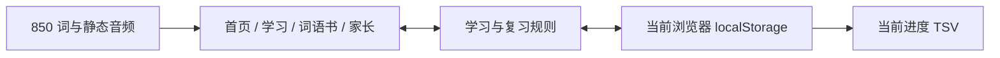

# 本地开发与静态发布

当前工程使用 React 19、TypeScript 5、Vite 7 和普通 CSS。界面与交互依据 [UX 设计](ux/UX_DESIGN.md)。浏览器先读取版本化固定词库，再加载页面和已有进度；声音按需读取静态 MP3，没有服务器端账户或进度数据库。



## 启动

需要 Node.js 22.12+ 或 24，以及 npm。普通开发和发布不需要 Python、语音模型或 API 密钥，生成后的素材随项目提供。

```powershell
npm ci
npm run dev
```

打开终端显示的本地地址。开发环境使用 hash 路由，刷新学习页面会恢复正式练习。一个网站来源保存一份进度；不同端口、域名或协议属于不同的浏览器存储空间。

## 检查

```powershell
npm run typecheck
npm run lint
npm run test
npm run content:check
npx playwright install chromium firefox webkit
npm run test:e2e
npm run build
npm run preview
```

- 规则测试覆盖逐字校验、复习日期、状态转换、唯一正式练习、损坏存储、写入失败、跨标签页和 TSV。
- 浏览器测试覆盖 Chromium、Firefox、WebKit 和 iPhone 尺寸模拟。包含实际 MP3 播放、完整一课、提示后焦点、刷新续学、自由练习和下载。
- 可访问性检查使用 axe-core，检查首页、查词、词卡、家长页和选择题。
- `content:check` 默认检查全部 850 词、170×5 编排、例句目标词、选项、静态音频和来源。`--text-only` 明确只检查文字；`--sample` 明确只检查前 20 词的内容。
- `content:check -- --release` 额外检查人工审校、审听和儿童试用的批准记录。自动测试不能替代这些工作，当前不宣称通过发布验收。

## 实现位置

| 内容 | 文件 |
| --- | --- |
| 页面与导航 | `src/pages/`、`src/app/` |
| 教学 / 复习转换和拼写 | `src/domain/session.ts` |
| 自然日、状态和课程统计 | `src/domain/progress.ts` |
| 版本化保存和多标签页冲突 | `src/services/storage.ts` |
| 单段音频播放与重试 | `src/services/audio.ts` |
| UTF-8 TSV 下载 | `src/services/export.ts` |
| 固定词表与教学内容 | `content/source-words.json`、`content/words.json` |
| 素材来源与制作记录 | `content/attributions.json`、`content/audio-model.json`、`content/audio-manifest.json` |

保存键为 `little-english-850`。每词仅保存当前教学状态和复习日期，另保存一份正式练习及声音设置。自由练习只存在于内存。统计、课程完成状态和导出行从这些记录计算。

复习中的当前目标词在查词列表和课程目录里先显示「正在复习的词」；点击后作为提示查看并立即保存提示标记，避免仅翻到列表就泄露答案。

数据不可读或版本不兼容时停止覆盖原值；保存失败时保留内存并显示重试。其他标签页写入后，旧页暂停编辑并要求读取最新进度。

## 修改教学素材

四份 UTF-8 TSV 是人工可编辑的教学文本，列为：`单词、中文核心义、英文例句、中文例句、Unicode 图示`。`support.json` 解释辅助词、词形和扩展用法。词卡使用系统表情字形或中文情境，不需要下载图片。

```powershell
python -X utf8 scripts/build-content.py
npm run content:check -- --text-only
```

编译器检查词条与固定来源完全一致，并生成应用词库及供署名页面下载的 `public/data/words.json`。更改课次或稳定 ID 前需要设计存档迁移；不要直接改 `contentVersion` 并覆盖旧进度。

重新制作音频时才需要 Python 3.12。制作模型保存在被忽略的 `.cache/`，中间文件和错误日志保存在 `tmp/`。

```powershell
python -m venv .cache/audio
.cache/audio/Scripts/python -m pip install -r scripts/audio-requirements.txt
.cache/audio/Scripts/python -X utf8 scripts/download-audio-model.py
.cache/audio/Scripts/python -X utf8 scripts/generate-audio.py
```

使用 Kokoro v1.0 int8，英语音色 `af_heart`、普通话音色 `zf_xiaoxiao`。一次生成一个文件，按文本、制作设置和文件哈希跳过未变内容；错误重试并写入 `tmp/content-errors.log`。`--limit 20` 可先制作前 20 词。`lead`、`wind`、`record` 等词在单词和例句中使用针对核心含义的音素覆盖。辅助词的英语声音也作为静态文件提供。

运行 `.cache/audio/Scripts/python -X utf8 scripts/verify-audio.py` 可逐文件解码，检查损坏、静音、时长和哈希。

生成文件的哈希和逐文件审听状态记录在 `audio-manifest.json`。文字由项目编写并明确标记为待人工审校的草稿；任何人都不应只为通过检查而把审校状态改为 `approved`。

## 发布准备

`npm run build` 输出 `dist/`，可由支持静态文件的 HTTPS 网站提供。上传整个目录，包括 `assets/audio/` 与 `data/`。相对路径和 hash 路由支持网站子目录，无需服务器路由回退，也无需向浏览器注入密钥。

发布后分别检查首页、深层 hash 链接刷新、MP3 的 `Content-Type` / 字节范围请求，以及 Safari 上的声音和 TSV 下载。HTML 使用短缓存；修改后的同名音频需要刷新 CDN 缓存。为稳定保留本地进度，应保持正式域名和协议不变。

公开发布前仍需逐词审校和审听，以及家长陪同的儿童试用、真实手机和平板键盘检查。托管账户、域名和 CI 的配置在实际发布时确定；本次开发没有部署到公共网站。

原 README 和实施基线仍描述开发前状态。按项目的文档修改偏好，将其阶段描述更新为当前开发状态属于待确认的文档跟进。
