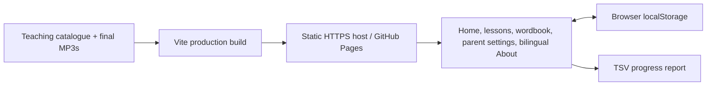

# Development and publication



Use Node.js 24, as recorded in `.node-version`, and `npm ci`. Node 22.12+ is also supported. The website has no backend, accounts or runtime API keys. Python and speech models are only needed when regenerating content.

## Commands

| Command | Purpose |
| --- | --- |
| `npm run dev` | Generate the compact catalogue and start Vite |
| `npm run typecheck` | TypeScript checks |
| `npm run lint` | ESLint |
| `npm test` | Learning, storage, recovery and export rules |
| `npm run content:check` | Full 850-word catalogue, audio files and provenance |
| `npm run content:check -- --release` | Also require actual editorial, listening and child-trial approvals |
| `npm run build` | Generate the catalogue, typecheck and build `dist/` |
| `npm run preview` | Serve the production build locally |
| `npm run test:e2e` | Browser tests against the development server |

Install browsers with `npx playwright install chromium firefox webkit` (Linux CI also uses `--with-deps`). To test the production build under a GitHub project path in PowerShell:

```powershell
npm run build
$env:PLAYWRIGHT_PRODUCTION = '1'
npm run test:e2e
Remove-Item Env:PLAYWRIGHT_PRODUCTION
```

This starts an isolated preview server on port 5175 at `/LittleEnglish850/`. Tests cover desktop Chromium, Firefox, WebKit and mobile WebKit, including routes, audio, progress recovery, export and bilingual About pages. Local emulation cannot replace real phone keyboards or target-network checks.

## Content and performance

`content/words.json` is the readable catalogue. `scripts/prepare-content.mjs` generates the ignored `src/data/words.generated.json`; Vite publishes it with a content hash. The app fetches this asset once, and the source-download link uses the same URL. There is no second checked-in public catalogue. Run `npm run content:prepare` after editing the catalogue during an existing dev session. Fetch preloading is intentionally omitted because tested WebKit versions download the same asset twice.

The wordbook retains its search and scroll state while hidden, but does not render its lists. Lesson lookups use the validated five-word ordering. Audio remains on demand.

Measured on 2026-10-12, three cold Chromium runs each, with 100 ms latency, 200 KB/s download, 4× CPU throttling and a local static server without gzip:

| Metric | Before | Release candidate |
| --- | ---: | ---: |
| Catalogue bytes | 1,130,227 | 760,737 |
| Catalogue gzip bytes | 97,058 | 89,060 |
| Homepage DOM elements | 596 | 61 |
| Median time until homepage is visible | 8,350 ms | 6,281 ms |

These measurements compare local builds, not live GitHub CDN performance. Gzip sizes are calculated separately; the timing test used uncompressed responses. No MP3 was requested on the homepage.

## Progress compatibility

Storage key: `little-english-850`. Preserve stable word IDs, ordering and `contentVersion` unless a compatible migration is supplied. There is one formal session plus per-word progress and settings. Free practice is temporary; course status and TSV rows are derived rather than stored as lesson history.

The release candidate fixes completed review spelling becoming unreadable after opening its wordbook card. A narrow parser repair restores the lost answer for the exact old hinted-session shape, retains all progress and hint flags, and then runs full validation. Other damaged or incompatible data remains untouched and blocks overwrites. Tabs detect conflicting writes.

## Versioning and GitHub

Work is prepared on `release/v0.1.0`; annotated candidate tags follow `v0.1.0-rc.N`. Keep package versions and `CHANGELOG.md` aligned. Source, authored content, provenance and final MP3 files belong in Git. Dependencies, builds, generated runtime JSON, models, temporary files and credentials are ignored.

The `Verify release` workflow uses GitHub-hosted Ubuntu 24.04 and Node 24, runs checks against the production subdirectory, and uploads `dist/` as an artifact. A PulseAudio virtual output lets headless Firefox play the actual MP3 files on a runner without speakers. Repository Actions access and the Git credential's `repo` / `workflow` scopes were verified during preparation. This workflow has read-only repository permissions and does not publish Pages.

When ready to publish:

1. Complete the real human reviews recorded in `content/attributions.json` and the audio manifest. Run the release check; do not change approval metadata just to pass it.
2. Confirm Pages eligibility for the private repository's plan, or deliberately choose public visibility. Pages is currently disabled.
3. Select **Settings → Pages → Source → GitHub Actions**, and add a deployment workflow that builds and publishes `dist/` after the same checks. Deployment needs `pages: write`, `id-token: write` and the `github-pages` environment.
4. Use the reviewed commit/tag. Keep the chosen HTTPS origin stable so local progress remains accessible.
5. Verify audio, spelling, refresh/resume, source downloads, TSV export and both About languages on the actual URL and on target mobile networks.

The expected project URL is `https://doraemonls.github.io/LittleEnglish850/`. Relative asset paths and hash routes support this layout without server rewrites. Moving from localhost to this origin does not transfer browser progress. Source attribution must remain available with the deployed site.
