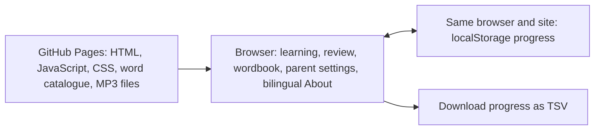

# GitHub Pages readiness review

Reviewed on 2026-10-12 against the current workspace, including its uncommitted application files.

GitHub Pages is suitable for the current product. A production build works from a repository subdirectory without a backend. Public release should wait for the confirmed saved-progress bug below, the existing content review gates, and verification of the destination repository and deployment permissions.

The review covered the application modules, components and styles; learning and storage rules; catalogue and audio tooling; tests; package and build configuration; source attribution; and the resulting static files. Content structure and audio integrity were checked automatically. This does not complete human editorial review, listening review, or trials with children and physical mobile keyboards.

**1. [P1] Viewing a word after successfully spelling it can save an unreadable review session.**

The `peek` handler in [session.ts](../src/domain/session.ts#L134) clears `session.input` whenever the current question is `spell`, including when spelling has already succeeded. It leaves `flags.spell.done` set to `true`. [storage.ts](../src/services/storage.ts#L39) rejects that combination on the next load because completed spelling requires the full answer.

Reproduced with the actual production build and synthetic progress:

1. Start an overdue review of `apple`.
2. Listen and spell `apple` correctly. Stay on the successful spelling screen, before pressing Continue.
3. Pause, open the wordbook, and open the current word's card.
4. Reload the page.

| Saved field | Before viewing the card | After viewing the card |
| --- | --- | --- |
| `session.question` | `spell` | `spell` |
| `session.input` | `apple` | empty |
| `session.flags.spell.done` | `true` | `true` |

The page then displays “学习记录暂时无法读取”. Retrying does not recover it. The original JSON remains stored, but normal learning and the parent export UI are blocked. The existing tests cover viewing a hint during incomplete spelling; they miss this completed-spelling case.

Before release, preserve the completed answer when marking the word as hinted, or reset the spelling state consistently. Add a regression covering success → wordbook peek → reload, including the review outcome. If this state has already reached users, provide a narrow recovery for these inconsistent sessions without discarding their word progress.

Local reproduction evidence is in `tmp/pages-review-storage-repro.json`, `tmp/pages-review-storage-repro.png`, and the runnable `tmp/pages-review-storage-repro.mjs`. No application fix was applied during this review.

**2. The project's public-release content gates still fail.**

[attributions.json](../content/attributions.json#L3) records pending editorial review, listening review, and child usability trials. Running `npm run content:check -- --release` checked the complete catalogue and returned exactly these three pending items. All 850 entries and the static audio structure passed the other checks in that run.

These are existing product acceptance requirements. Automated file decoding establishes that audio is present and usable; it does not establish that all pronunciations, translations, examples, or teaching choices are correct. Complete the actual review work before changing approval metadata.

**3. Deployment preparation is incomplete and destination access is unverified.**

- The configured remote is `https://github.com/Doraemonls/LittleEnglish850.git`. Reading that repository through the authenticated GitHub CLI returned HTTP 404. This can mean a missing repository or insufficient access; it does not establish which. Repository visibility, Pages settings, Actions availability, and deployment permissions could not be verified.
- Only the two original planning documents are tracked by Git. The application, lockfile, configuration, tests and static assets remain untracked, so publishing the existing commit would not publish this application.
- There is no `.github/workflows` deployment configuration. `dist/` is correctly ignored. A deployment must build and upload `dist/`, rather than serve the Vite source root.

Once the repository and permissions are verified, GitHub Actions is a suitable deployment method: install a supported Node version, run `npm ci`, run the checks, build, upload `dist/` with the Pages artifact action, and deploy through the Pages environment. Node 22.12+ or Node 24 matches the current tooling requirements. Python and speech models are only needed when regenerating materials; they are not required to publish the prepared website. No workflow, repository setting, commit, push or deployment was created during this review.

**Hosting compatibility and limits**

| Current feature | GitHub Pages suitability | Practical behavior |
| --- | --- | --- |
| Lessons, spelling and spaced review | Suitable | Rules execute in the browser. |
| Search, courses and bilingual About | Suitable | Static data and hash routes; no server route rewrites needed. |
| Recorded pronunciation | Suitable | MP3 files load on demand from the same site. |
| Saved progress | Suitable | Saved in the current browser's localStorage for that website origin. |
| Progress export | Suitable | The browser creates and downloads the TSV file. |

The existing `base: './'` in [vite.config.ts](../vite.config.ts#L5), hash navigation, and `import.meta.env.BASE_URL` resource loading work for a project site such as `https://doraemonls.github.io/LittleEnglish850/`, assuming that repository is the intended destination. The relative base does not require a change for the tested layout.

The current `dist/` contains 2,879 files totaling 31,238,066 bytes, approximately **29.79 MiB**, including 2,873 MP3s. The largest file is the approximately 1.08 MiB catalogue. Audio is requested as needed; the entire audio library is not loaded on the homepage.

GitHub's published limits, checked during this review, include a **1 GB maximum published site size**, a **100 GB/month soft bandwidth limit**, and a **10-minute deployment timeout**. This build is comfortably within the size limit. Bandwidth consumption depends on actual visits and audio playback. GitHub Pages is available for public repositories on GitHub Free; private-repository availability depends on the account plan.

Local progress does not automatically transfer from localhost to the public site, between browsers/devices, or to a different domain. Clearing browser data removes that progress. The current export is a progress report, consistent with the requested first-version scope. There is no offline service worker, cloud sync, account backend, or live AI API integration. Those features would require separate implementation if added later.

For a mainland-China audience, verify the final domain's loading and audio latency on the intended users' networks. Local browser tests cannot establish GitHub CDN availability or performance from those networks.

**Verification results**

| Check | Result |
| --- | --- |
| TypeScript and production build | Passed |
| ESLint | Passed |
| Domain/storage/export tests | 29 passed |
| Existing browser suite | 49 passed; 3 duplicate DOM accessibility audits skipped by configuration |
| Browser coverage | Chromium, Firefox, WebKit and mobile WebKit emulation |
| Known dependency vulnerabilities | `npm audit`: 0 reported across production and development dependencies |
| Full catalogue and audio release check | Structural checks passed; 3 human release gates pending |
| MP3 integrity | All 2,873 decoded; hashes, durations, non-silence and sample integrity passed; approximately 57.8 minutes |
| Source vs published catalogue | `content/words.json` and `public/data/words.json` are byte-identical |
| Production files under `/LittleEnglish850/` | Routes and reloads, Chinese/English About, listening, spelling and TSV export passed in Chromium, Firefox and mobile WebKit |
| Production subdirectory requests | No incorrect root paths, HTTP errors or JavaScript errors in the smoke checks |
| New saved-progress reproduction | Confirmed the P1 bug described above |

The production smoke checks used a local static server with the repository path prefix, MP3 MIME type and byte-range support. They verified the generated artifact, not a live GitHub Pages deployment. Actual Pages response headers, CDN behavior, permissions and target-network performance remain to be checked after deployment. Production-check details are in `tmp/pages-review-production-results.json`.

The automated suite passing does not override the separately reproduced saved-progress bug. Future content-version changes also require care: the current parser intentionally rejects a different `contentVersion`. Define compatibility or a migration before publishing such a change if existing progress must remain readable.

**Documentation follow-up**

[README.md](../README.md#L5) still says the application has not been built. The product and implementation documents describe the earlier page set and omit the About page. Update those descriptions when preparing the release. Existing documents were left unchanged in accordance with the project's documentation preference.

Official references checked:

- [About GitHub Pages](https://docs.github.com/en/pages/getting-started-with-github-pages/what-is-github-pages)
- [GitHub Pages limits](https://docs.github.com/en/pages/getting-started-with-github-pages/github-pages-limits)
