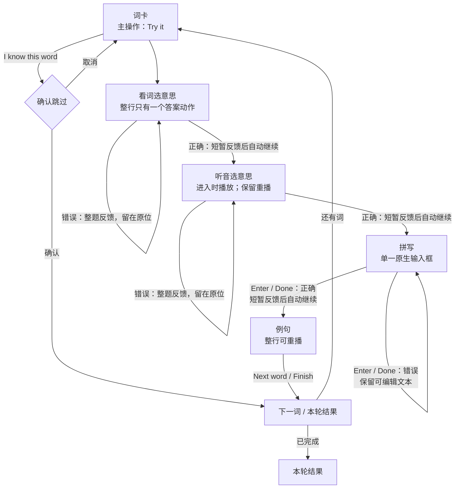

# 学习交互审计与修订方向

2026-10-20 · 已实施并纳入当前产品 · [查看交互修订图板](sunny-memphis/08-interaction-revision.svg)

实施状态：UX-01 至 UX-11 已完成。测验正确后自动推进，答案行合并为单一动作，拼写改为整词提交，听音与拼写进入时自动播放，常态 Hint、提示横幅和首次强制教学均已移除。旧存档中的提示字段继续兼容，但不再作为常规界面入口。

## 问题清单

| 编号 | 优先级 | 当前问题 | 证据 / 影响 | 建议修复 |
| --- | --- | --- | --- | --- |
| UX-01 | P0 | 正确作答后的下一步看起来“消失” | `Continue` 是在答案列表下方临时插入的。在 390 × 550 视口中，看词题按钮底部为 554 px，听音题为 579 px，均超出 550 px；iPhone 13 视口中也分别超出约 4 px 和 29 px。选项顺序随机，正确答案处于不同位置时，用户看到的滚动位置不同，因此表现为“有时发生”。 | 选择题正确后不再要求第二次点击 `Continue`；短暂显示整体正确反馈后自动进入下一步。仍需明确按钮的词卡和例句页，将主按钮放在稳定、始终可见的底部操作区。 |
| UX-02 | P0 | 一个选项行看似一个控件，实际是两个互相竞争的动作 | 每个 `.choice-row` 内同时包含答案按钮和 44 px 扬声器按钮。点击扬声器只播放中文、不提交答案，也不会出现下一步；但整行共享边框、悬浮和按压视觉，容易被理解为同一个答案控件。 | 练习题中的每一行只保留一个答案动作，整行均可点击。移除选择题中的独立中文扬声器；中文发音保留在词卡和词语书等非答题场景。 |
| UX-03 | P0 | 拼写页同时显示真实输入框和一排拆分字母格 | `SpellingInput` 渲染一个原生输入框及一套 `letter-slots`，同一输入出现两次，形成两个视觉焦点。 | 只保留一个原生输入框，删除字母格。输入框本身承担输入、焦点、完整答案状态和错误反馈。 |
| UX-04 | P0 | 拼写规则逐字判定并在首个错误字母时清空 | `spellEdit` 将每次输入与目标字母当前位置比较；错误、粘贴或整词输入会清空。孩子无法像普通文本框一样完成输入、检查和修改，这也正是字母格设计存在的原因。 | 改为“先自然输入完整答案，再整体检查”。`Enter` / 手机键盘 `Done` 提交；错误时保留文本并选中或允许编辑，只显示整词级 `Try again`，不标记单个字母对错。 |
| UX-05 | P1 | 每个正确答案都需要“作答 → 找反馈 → 再点继续” | 当前每词至少需要 9 次控件操作（不含实际打字）；五词课程约有 45 次。重复的 `Continue` 没有新的决定价值，并造成布局跳动。 | 看词、听音和拼写在正确反馈后自动推进；词卡保留 `Try it`，例句保留 `Next word / Finish`，因为这两处仍代表真实决定。预计每词降至约 5 次明确操作。 |
| UX-06 | P1 | 听音和拼写先要求用户理解提示，再点击音频，之后才能作答 | 页面同时出现标题、中文副标题、大播放按钮和“先点上方大喇叭”横幅；首次入门还有三步教学弹窗。界面依赖说明文字来解释自身。 | 进入听音或拼写步骤时，由前一步的用户手势启动目标单词音频；页面仅保留清楚的重播按钮。若浏览器阻止播放或音频失败，才显示必要的恢复操作。移除常态横幅。 |
| UX-07 | P1 | `Hint` 是常态操作，会打断任务并清空拼写输入 | 每个未完成测验均显示 `Hint`；弹窗展示答案，关闭后清空输入，并使本轮失去独立通过资格。它既是额外动作，也改变进度含义。 | 从主流程移除常驻 `Hint`。如确需保留帮助，仅在连续失败后显示一个低优先级入口，并明确“查看答案会重新练习”；不使用提示来解释点击位置。 |
| UX-08 | P1 | 鼠标、触屏与键盘的听音状态不一致 | 点击音频按钮要等播放结束才设置 `heard`；按空格却立即设置 `heard`。正确选项获得/保留焦点时，全局 Enter 因“交互元素”检查而不继续。 | 所有输入方式调用同一事件和状态路径；仅在音频达到同一完成条件后开放答题。自动推进后，不再依赖焦点寻找 `Continue`。 |
| UX-09 | P1 | 正确反馈、下一步和内容高度一起变化，缺少稳定操作位置 | `Correct!` 和 `Continue` 都在作答后才加入 DOM；页面高度及滚动范围改变。移动端没有为主操作预留空间。 | 为反馈预留固定高度；需要显式按钮的页面采用底部操作区，并考虑安全区域。反馈只表达结果，不再同时要求用户寻找新动作。 |
| UX-10 | P2 | 首次学习前的三步教学与目标界面重复，且教学内容将过时 | `Onboarding` 需要三次 `Next / Try it`，并明确教“逐个输入字母”，与本次要求的自然整词输入冲突。 | 取消强制教学弹窗。家长页可保留可选的“使用说明”，但内容改为一页、只说明声音与进度，不教学显而易见的点击动作。 |
| UX-11 | P2 | 设计文档与实现不一致 | 设计说明称拼写使用“单一原生输入框”，实际界面仍显示输入框和字母格；既有交互图还明确要求孩子点击 `Continue`。 | 方案确认后先更新 UX 文档、交互图和拼写稿，再修改状态机与界面，避免设计与代码再次分叉。 |

## 根因判断

“下一步有时缺失”不是正确答案丢失或状态机未完成。当前状态机在正确答案后会设置 `done`，React 也会渲染 `Continue`。实际有两个可重复的感知原因：

1. 新按钮被追加在列表底部，但没有进入当前可视区；随机选项位置使滚动上下文每次不同。
2. 选项右侧扬声器属于同一个视觉行，却不会提交答案；用户认为已选择，系统认为只播放了声音。

相关实现位于：

- `src/pages/Learn.tsx:137-166`：音频、选项、反馈、`Continue` 和 `Hint`。
- `src/components/SpellingInput.tsx:50-73`：输入框与字母格同时渲染。
- `src/domain/session.ts:53-101`：逐字拼写校验及显式 `next` 状态转换。
- `src/components/Onboarding.tsx:11-18`：三步教学及“逐个输入字母”。

## 修订原则

1. 一个页面只有一个主要意图；次要动作不能伪装成同一个点击区域。
2. 正确答案不再要求重复确认；错误答案留在原处自然重试。
3. 布局本身说明哪里可点击、哪里可输入，不用常态提示横幅补救。
4. 反馈只说明结果；音频失败、保存失败、跳过确认等例外仍保留明确操作。
5. 鼠标、触屏、键盘和屏幕阅读器走同一状态路径。

## 建议的新学习流程

复习沿用同一组件与反馈规则，仅从 `Spell` 开始：

## 各步骤的目标状态

| 步骤 | 默认状态 | 用户唯一主要动作 | 正确后 | 错误后 |
| --- | --- | --- | --- | --- |
| 词卡 | 单词、图片、发音可见 | `Try it` | 进入看词题 | 不适用 |
| 看词选意思 | 3 个完整答案行 | 点击一行 | 整题变绿并自动继续 | 整题级 `Try again`，继续选择 |
| 听音选意思 | 单词音频开始播放，重播按钮可见 | 点击一行 | 整题变绿并自动继续 | 整题级 `Try again`，继续选择 |
| 拼写 | 音频开始播放，单一输入框自动聚焦 | 输入后按 `Enter / Done` | 输入框整体成功并自动继续 | 输入框整体错误，文本可编辑；无逐字标记 |
| 例句 | 句子整行可重播 | `Next word / Finish` | 下一词或结果 | 不适用 |

## 保留的安全例外

- `I know this word` 继续保留确认，因为会直接改变学习进度。
- 保存失败、音频失败和跨标签页冲突继续要求明确恢复操作。
- 暂停与离开继续保留显式选择，避免意外中断。
- 正确反馈应有约 0.8–1.2 秒的可见停留，但不依赖动画表达状态。

## 已完成的实施顺序

1. 已更新 `docs/ux` 中的学习页、拼写页和交互图。
2. 已修改拼写状态模型与单元测试，改为完整字符串提交。
3. 已合并选项行点击区域，移除题内扬声器和常态提示。
4. 已实现正确答案自动推进、稳定反馈区及音频统一事件路径。
5. 已补充移动端可视区、键盘、音频失败和完整课程端到端测试。
