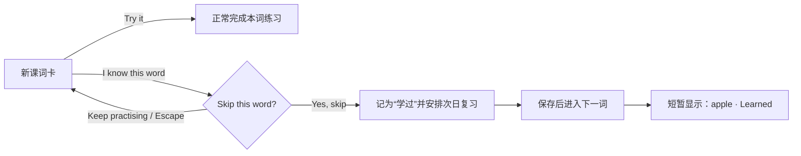

# 已会单词跳过｜UI/UX 设计

2026-10-19 · [查看视觉稿](sunny-memphis/07-skip-word.svg) · [Sunny Memphis 设计总览](sunny-memphis/DESIGN_NOTES.md)

## 目标

让已经完全认识当前单词的孩子快速继续，同时避免误触，也不破坏“记牢了”必须经过独立复习的含义。

## 入口与文案

- 入口只出现在**新课的词卡步骤**，位于主操作 `Try it` 下方。
- 次要按钮使用 `I know this word`，辅助说明为 `Skip and review it later`。
- `Try it` 保持向日葵黄主按钮；跳过按钮使用白底、深色边线和绿色勾形，不与主操作争夺注意力。
- 复习、自由练习、选择题、拼写题和句中听读不显示此入口。

## 交互流程

确认弹窗明确说明：`We’ll mark “apple” as learned and review it later.` 安全选项 `Keep practising` 首先获得键盘焦点。遮罩、Escape 或安全选项都会关闭弹窗并返回原按钮，不改变任何学习记录。

## 学习规则

| 行为 | 结果 |
| --- | --- |
| 点击 `I know this word` | 仅打开确认，不改进度 |
| 确认 `Yes, skip` | 当前词首次教学记为完成，状态成为“学过” |
| 复习安排 | 次日进入正常到期复习 |
| 掌握阶段 | 保持 0，不直接成为“记牢了” |
| 课程进度 | 当前词计入本轮完成数，进入下一词或本轮结果 |
| 保存失败 | 保留当前词并显示既有保存失败反馈，不提前进入下一词 |

最后一个词被跳过时直接进入本轮结果页。结果页的练习词数包含跳过的词；后续实现可在结果摘要中另列“Skipped 1 word”，但不增加庆祝强度。

## 可访问性与适配

- 入口和弹窗操作的点击区域至少为 44 × 44 px；手机稿中使用 56 px 高按钮。
- 弹窗使用语义化对话框、标题关联和焦点锁定；关闭后焦点返回 `I know this word`。
- 确认成功后，下一张词卡正常获得上下文，`apple · Learned` 通过礼貌级实时区域同步播报。
- 颜色之外同时使用勾形和文字表达“学过”。
- 尊重减少动态效果设置；成功提示不依赖动画，显示约 3 秒后收起。

## 评审重点

1. 是否接受按钮文案 `I know this word`，而不是更直接但语气较弱的 `Skip`。
2. 是否接受“跳过 = 学过并次日复习”，而不是直接记为“记牢了”。
3. 是否需要在本轮结果页单独显示跳过词数。

本稿已在应用中实现；领域规则、界面状态与自动化测试保持一致。
