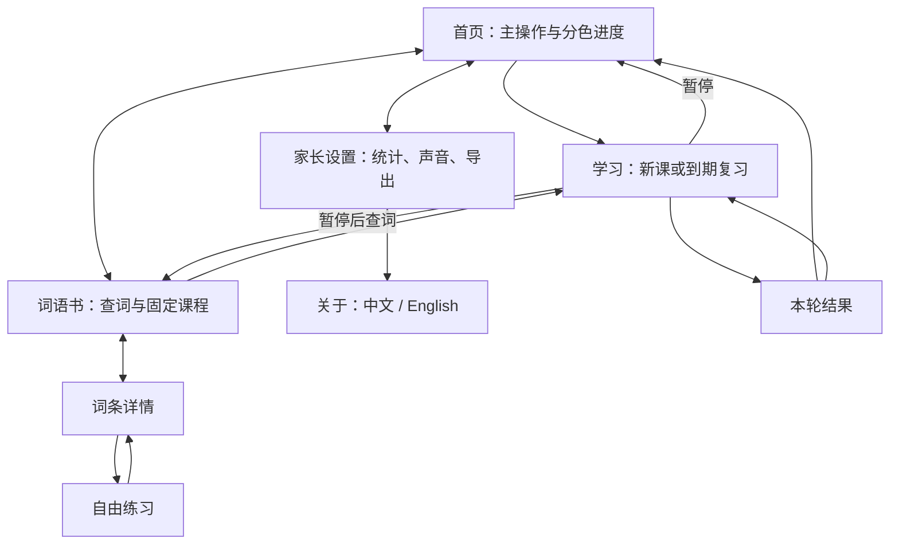
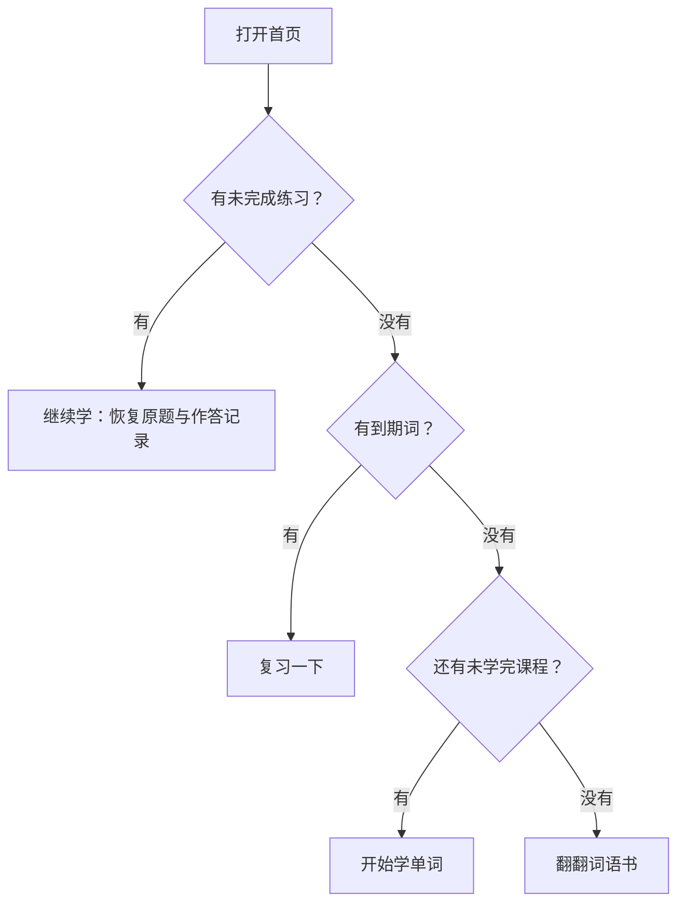
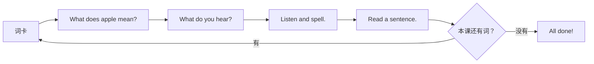
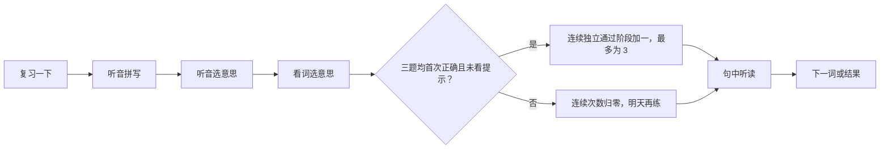
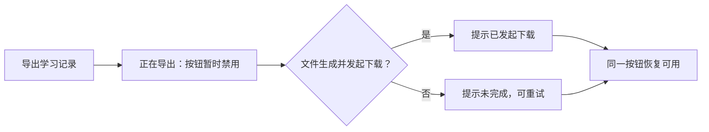

# Little English 850｜页面与交互设计

2026-10-19 · [Sunny Memphis 设计总览](sunny-memphis/index.html) · [视觉与组件说明](sunny-memphis/DESIGN_NOTES.md) · [已会单词跳过设计](SKIP_WORD_DESIGN.md)

首页连接学习、词语书与家长设置，家长设置连接双语关于页。学习从单词开始，每次只呈现一张词卡或一道题。

图板是布局样例，实际进度由当前存档计算。学习和保存规则见 [PROJECT.md](../../PROJECT.md)。

| 图板 | 内容 |
| --- | --- |
| [00 视觉方向](sunny-memphis/00-direction.svg) | 明黄、天蓝、绿与珊瑚红；白色阅读区；常规字重句子 |
| [01 首页](sunny-memphis/01-home.svg) | 桌面与手机、进度和开始入口 |
| [02 学习](sunny-memphis/02-learning.svg) | 词卡、选意思、听音选择、拼写、句中听读 |
| [03 词语书](sunny-memphis/03-wordbook.svg) | 列表、详情和课程 |
| [04 家长设置](sunny-memphis/04-parent.svg) | 统计、声音和导出 |
| [05 关于](sunny-memphis/05-about.svg) | 中英文内容与顶部标语 |
| [06 交互](sunny-memphis/06-interactions.svg) | 页面关系及必要反馈 |
| [07 已会单词跳过](sunny-memphis/07-skip-word.svg) | 新课词卡入口、确认与跳到下一词后的反馈 |
| [08 学习交互修订](sunny-memphis/08-interaction-revision.svg) | 单一答案动作、自动推进、自然拼写输入与安全例外；取代 06 中旧的学习题交互 |

## 首页与学习进度

白色卡片中依次为书本插画、简短标题、“我的单词”分色进度、一个主操作和词语书入口。精确词数与百分比放在家长设置。

| 区段 | 颜色 | 含义 |
| --- | --- | --- |
| 记牢了 | #FFC938 向日葵黄 | 连续三次到期复习独立通过 |
| 学过 | #287A55 深绿 | 首次教学完成，继续巩固 |
| 正在学 | #ACDF82 浅绿 | 已进入词卡，首次教学尚未完成 |
| 未开始 | #E8EFEA 浅灰 | 尚未开始首次教学 |

各段按唯一词数占 850 词的比例绘制，不固定示例百分比。色条配三个短图例，读屏提供完整词数。记牢了的词继续按 30 天间隔巩固。词语书浏览和自由练习不改变正式进度。

## 学习：看、听、拼、读

新课词卡另有一个次要入口 `I know this word`。孩子确认后，当前词记为“学过”、安排次日复习，并直接进入下一词；它不会直接成为“记牢了”。入口不出现在复习或自由练习中，避免绕过复习判定。完整状态、文案与焦点规则见[已会单词跳过设计](SKIP_WORD_DESIGN.md)。

学习页的导航、提问、操作和反馈使用简短英语；中文释义与例句翻译保留。题目标题及例句使用 400 常规字重，目标单词保留大字号。首页、词语书和家长设置使用中文；关于页可切换语言。

| 视图 | 操作与反馈 |
| --- | --- |
| 词卡 | 图片或情境、英文、中文、单词音频与例句；Try it 进入练习 |
| 看词选意思 | 英文提问，中文加已有 emoji 的纵向答案列表；整行是一个动作，正确反馈停留约一秒后自动继续 |
| 听音选意思 | 进入时自动播放目标词，完整播放后启用选项；保留一个重播控件，正确后自动继续 |
| 拼写 | 进入时自动播放目标词；在单一原生输入框自然编辑，按 Enter / Done 整词检查，正确后自动继续 |
| 句中听读 | 点击英文例句整行播放，中文翻译在下一行；Next word 或 Finish 继续 |
| 本轮结果 | All done! 与实际练习词数；返回首页或继续学习；自由练习返回词条 |

练习题每个选项只有一个整行答案动作，不放独立中文扬声器。所有播放共用单一播放器，点击新音频会停止原音频。例句同时支持 Enter / 空格，播放时句子保持可见，播放本身不推进学习步骤。

拼写题隐藏完整答案，使用一个原生输入框保留系统键盘与焦点。孩子可以正常输入、粘贴、选择和修改，按 Enter 或手机键盘 Done 后才按完整答案核对；大小写不敏感。错误时显示整词级 Try again，保留并选中文本以便继续编辑，不逐字标错也不清空。常规学习流程不显示 Hint。

暂停弹窗显示是否保存，提供继续、首页或词语书入口。刷新恢复正式练习的原题、输入内容及错误记录。

### 到期复习

复习每轮最多 10 词，每词三题完成后统一结算。错误或提示标记即时保存，日期与阶段遵循[复习规则](../../PROJECT.md#4-复习规则)。

## 词语书与课程

“查单词 / 看课程”切换位于搜索区上方。查词支持英文、中文、学习状态和固定课次筛选；列表显示词义及“未开始 / 正在学 / 学过 / 记牢了”。空结果提供清除搜索与筛选。

词条详情共用词卡和例句播放组件。返回列表保留搜索、筛选与滚动位置；自由练习使用临时页面状态，返回或刷新后可重新开始，保留正式练习的续学位置。

固定课程由每词的首次教学状态计算“未开始 / 未学完 / 已学过”。有正式练习时提供一个继续入口；完成后可开始尚未学完的指定课程。保存当前词进度、唯一正式练习与设置，课程状态由这些记录计算。

复习途中浏览列表时隐藏当前未结算词的答案；打开其详情或自由练习会记录本轮提示。已经完成的题目保持完成，独立通过判定仍考虑提示标记。

## 家长设置与导出

桌面使用左侧概览、右侧声音和导出的两列布局；手机为单列。概览显示四个状态的数量和百分比，以及累计学过和待复习数量。累计学过为“学过 + 记牢了”。声音设置包含中文语音引导开关、音量、试听和可选的一页家长使用说明；首次课程不再强制显示教学弹窗。

进度与设置自动保存在当前浏览器。唯一数据操作“导出学习记录”生成 UTF-8 TSV，文件名为 `little-english-progress-YYYYMMDD-HHmmss.tsv`。文件包含完整 850 词和中文表头，可用表格软件或文本编辑器查看；字段见[保存与导出](../../PROJECT.md#6-保存与导出)。

## 关于、错误状态与设备适配

关于页从家长设置进入，中文与英文各有稳定链接。标语位于正文最上方，随后介绍 Ogden 的 850 词、初学者的使用方式和 AI 时代学习的意义，并提供来源链接。

| 状态 | 反馈与操作 |
| --- | --- |
| 音频失败或静音 | 显示可重试的短反馈；听音题保持未完成 |
| 保存失败 | 提醒暂不关闭页面，可重试保存；保留内存中的练习 |
| 原存档无法读取 | 保留原数据，重试读取 |
| 另一页更新存档 | 暂停旧页操作，读取最新进度再继续 |
| 内容加载失败 | 显示重新加载入口 |

手机和桌面共用原生按钮、输入框、选择器及弹窗，交互目标至少 44 px。学习卡居中，长词和长句换行；键盘出现时输入保持可见。装饰使用少量固定圆点、短波纹和小 emoji，位于阅读区之外；学习题背景仅用抽象图形。必要反馈用文字与图标表达，焦点外圈清楚可见。

依据：[产品说明](../../PROJECT.md)、[开发说明](../DEVELOPMENT.md)、[内容与素材规范](../CONTENT.md)。
