# Little English 850｜页面与交互设计

页面交互说明 · 更新：2026-10-12。保留的 SVG 为最初的布局图稿，当前界面已经精简提示文字。

学习主线：**单词词卡 → 辨认词义 → 听音拼写 → 句中跟读 → 到期复习**。

## 1. 页面总览

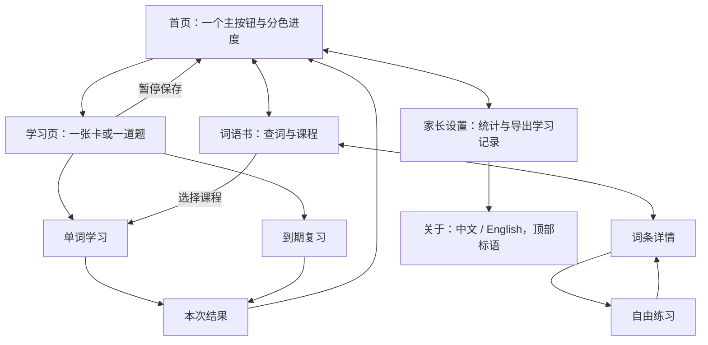

SVG 同时用于编辑和预览。图中词条与数量为示例；产品行为以 [PROJECT.md](../../PROJECT.md)为准。

| 图板 | 内容 | 查看 |
| --- | --- | --- |
| 01 首页 | 首次使用、继续学习、到期复习、课程学完 | [设计图](01-home.svg) |
| 02 进度条 | 三种颜色、比例示例、状态变化 | [设计图](02-progress.svg) |
| 03 单词学习 | W1 词卡、W2 看词选意思、W3 听音选意思、W4 拼写 | [设计图](03-words.svg) |
| 04 练习反馈 | R1 出错、R2 跟读、R3 复习、R4 完成 | [设计图](04-practice.svg) |
| 05 词语书 | B1 列表、B2 详情、B3 空搜索、B4 固定课程目录 | [设计图](05-wordbook.svg) |
| 06 家长设置 | P1 概览、一键导出流程、文件内容与按钮反馈 | [设计图](06-parent.svg) |

## 2. 首页：直接开始学单词

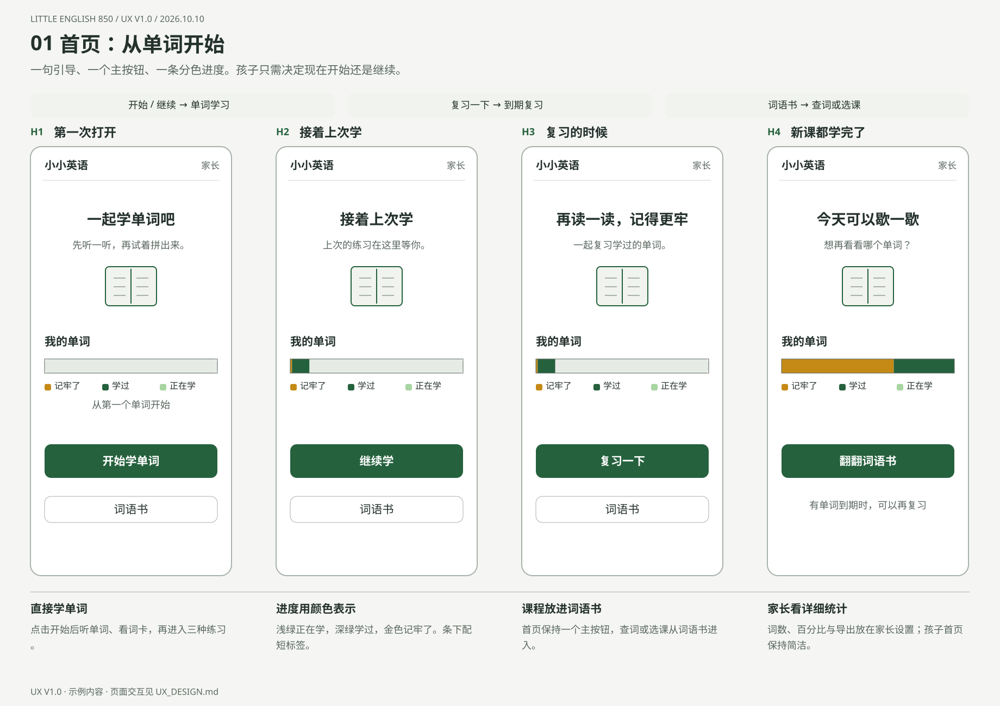

从上到下：小标题与家长入口 → 一句引导 → 「我的单词」分色进度条 → 一个大主按钮 → 词语书入口。首页用颜色和短标签表达整体进度；课程列表在词语书内，精确统计在家长设置内。

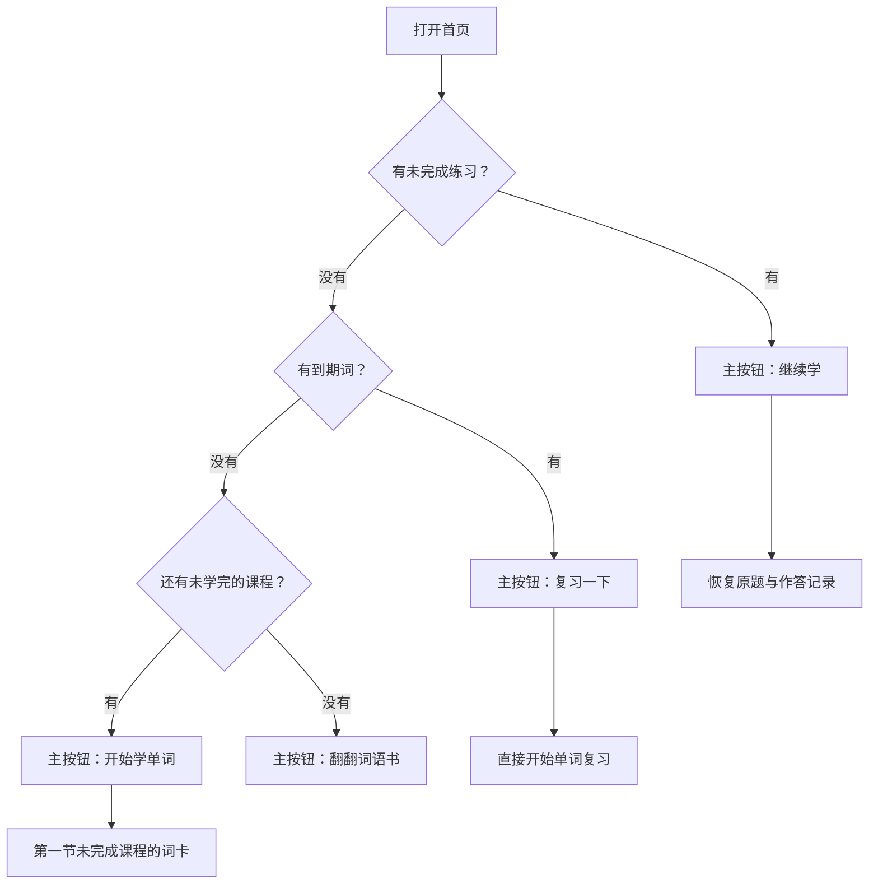

| 状态 / 操作 | 界面回应 |
| --- | --- |
| H1 首次使用 | 「一起学单词吧」；进度条为空；点击「开始学单词」进入可跳过的操作示范，然后展示第一张词卡 |
| H2 继续学习 | 「接着上次学」；点击「继续学」恢复唯一的当前正式练习及其题目、输入和本轮错误 / 提示记录 |
| H3 到期复习 | 「再读一读，记得更牢」；点击「复习一下」直接进入最多 10 词的一轮 |
| H4 首次教学全部完成且暂无到期词 | 「今天可以歇一歇」；显示当前分色进度；点击「翻翻词语书」查阅或自由练习 |
| 点击「词语书」 | 查看词条或固定课程目录；没有进行中练习时，可在到期复习前自主选择新课 |
| 点击「家长」 | 打开详细统计、声音设置和「导出学习记录」按钮 |

学习题目的「2/5」等短轮次进度继续保留，帮助孩子判断当前练习还剩多少。

## 3. 一条进度条表达三个学习阶段

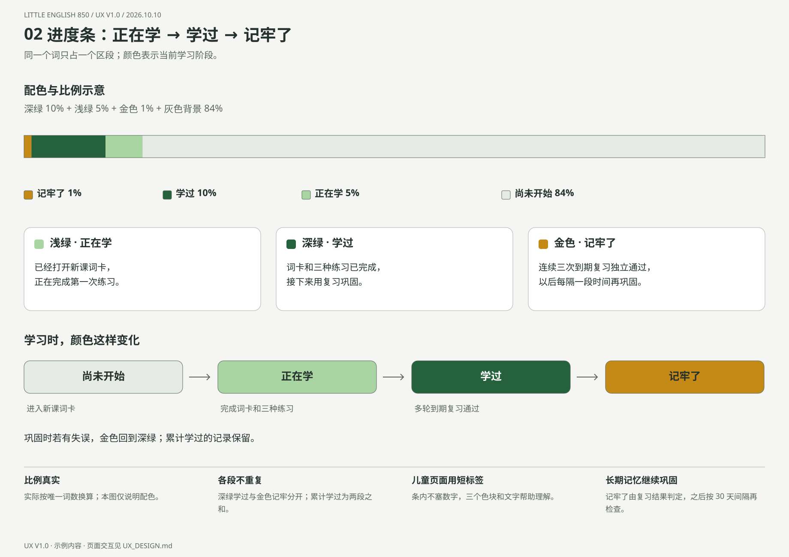

| 顺序 | 标签 | 颜色 | 状态含义 |
| --- | --- | --- | --- |
| 1 | 记牢了 | 金色 #C58A16 | 连续三次到期复习独立通过 |
| 2 | 学过 | 深绿 #25613D | 首次教学已完成，当前还需继续巩固 |
| 3 | 正在学 | 浅绿 #A8D5A2 | 已进入新课词卡，首次教学尚未完成 |
| 4 | 背景 | 浅灰 #E7EBE5 | 尚未开始首次教学 |

- 图板 02 的配色比例示意：深绿 10%、浅绿 5%、金色 1%、背景 84%。该图解释区段，不代表首版真实存档；实际逐词教学最多一个新词处于「正在学」。各段独立计数，累计学过是深绿与金色之和。
- 实际段宽按唯一词数占全部词表的比例计算，不把示例百分比固定成目标。
- 儿童首页条内保持干净，条下显示对应色块与「记牢了 / 学过 / 正在学」三个标签；精确比例放在家长设置中。
- 金色窄段位于条首，靠图例解释；小于一个显示像素时仍保留真实比例，由图例和读屏说明其状态。
- 记牢了的词继续按 30 天间隔巩固；该标签表示多次复习的结果。
- 配色搭配文字，不只依赖颜色区分；浅色段内不放白色文字。

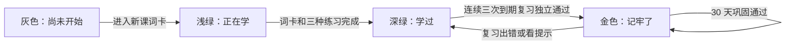

词语书浏览和自由练习不改变进度条。每词三题完成时统一更新正式进度；出错和提示标记随时保存。记牢词在本轮复习失败结算后回到深绿，首次教学完成的记录保留。初次使用显示灰色空条与「从第一个单词开始」。

## 4. 学习页：单词与句子

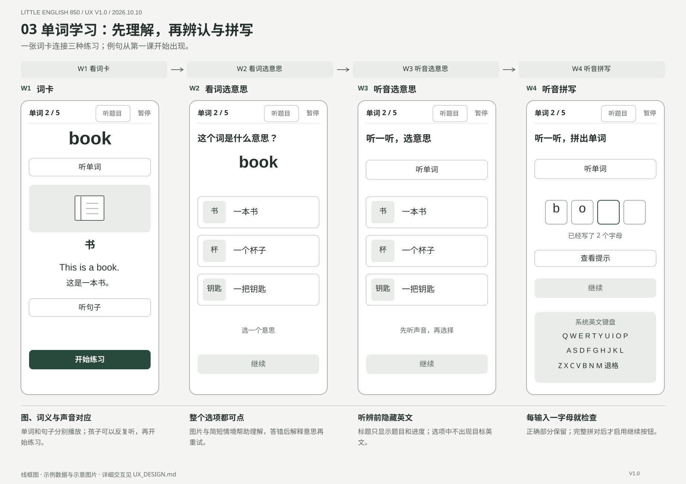

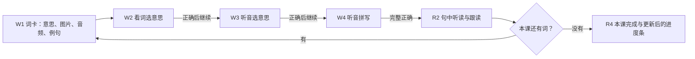

| 视图 | 内容与操作 | 反馈 |
| --- | --- | --- |
| W1 词卡 | 英文、中文、图片 / 情境、单词与句音频；「开始练习」 | 可反复听，开始后进入 W2 |
| W2 看词选意思 | 显示英文，从 2–3 个图片或情境中选择 | 答对显示「选对了」与「继续」；答错解释后重试 |
| W3 听音选意思 | 播放音频，显示意义选项 | 作答前隐藏英文，反馈方式同 W2 |
| W4 听音拼写 | 播放、输入区、提示入口 | 每个字母核对；完整正确后启用继续 |
| R2 句中跟读 | 突出句中的目标词、中文解释、完整句音频 | 反复听读或点击「下一个词」；最后一词显示「完成本课」 |
| R4 本课完成 | 「这次学会了 5 个词」、更新后的分色进度条 | 「今天到这里」回首页，或「再学 5 个词」 |

句中跟读可直接继续。例句辅助词可点开中文和音频提示，关闭后回到句子。本课结果按实际完成数量显示；全部新课完成时，后续入口改为首页和词语书。

### 拼写、提示与出错

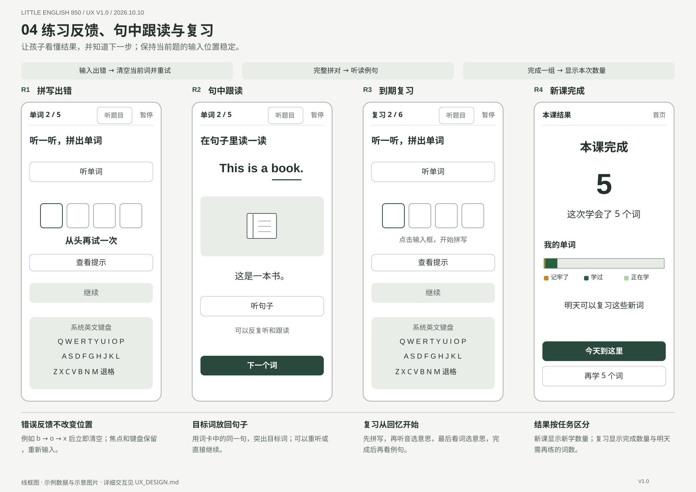

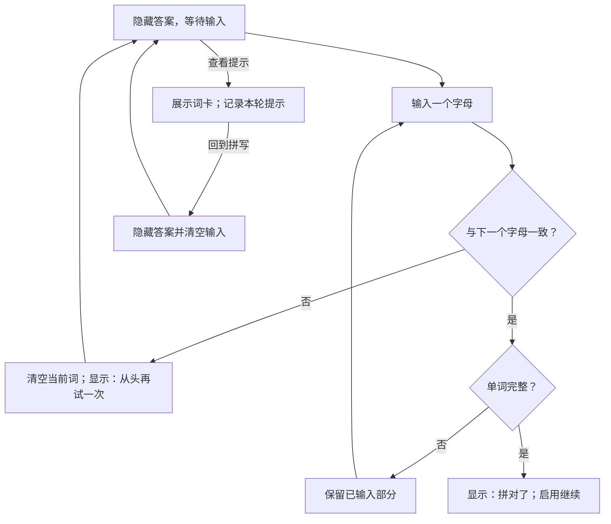

输入 book 时，b → o → x 使当前词输入立即清空，焦点与键盘保留；重新完整输入后才可继续。首字母、末字母出错也相同。错误与提示记录随本轮保存。

| 操作 | 回应 |
| --- | --- |
| 重听 | 保留输入，播放当前音频，避免声音叠加 |
| 查看提示 | 展示词卡；返回后隐藏答案、清空输入 |
| 退格与大写 | 退格撤回一字母，大写按小写校验 |
| 长词与分隔符 | 单一输入控件连续作答；字母格按宽度换行，当前字母可见；分隔符固定呈现 |
| 粘贴或整词补全 | 不作为完成答案，提示逐个输入字母 |
| 非字母功能键 | 保持当前作答状态 |
| 拼写题显示 | 标题、图片说明、例句等均隐藏完整答案 |

### 到期复习

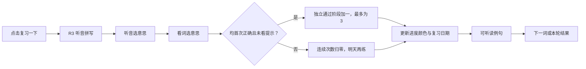

每题答错都须重试完成才进入下一题；复习每轮最多 10 词，先完成检查再展示例句。每词三题完成后统一结算；日期与阶段沿用[项目复习规则](../../PROJECT.md#4-复习规则)。

复习结果显示「这次复习了 6 个词」，有失误时补「其中 2 个词明天再练习」，并更新进度条。自由练习完成后返回原词条，不改正式学习与复习状态。

## 5. 词语书：查词与选择课程

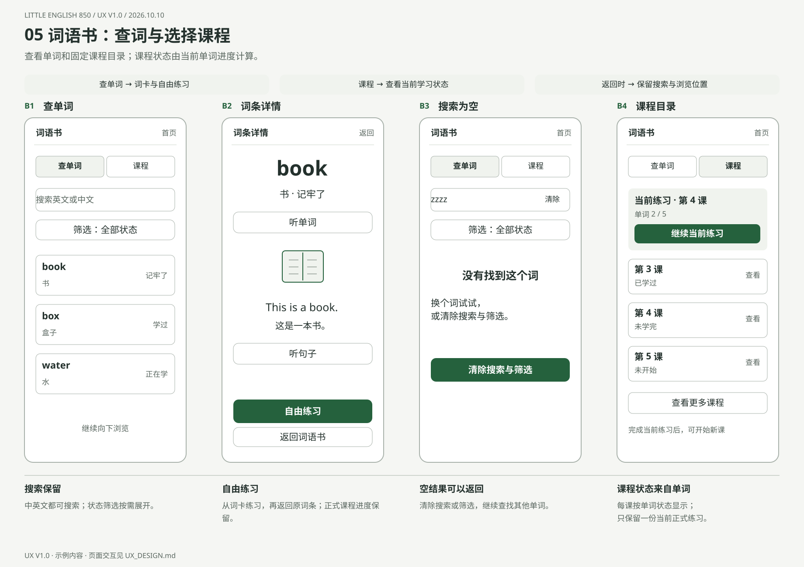

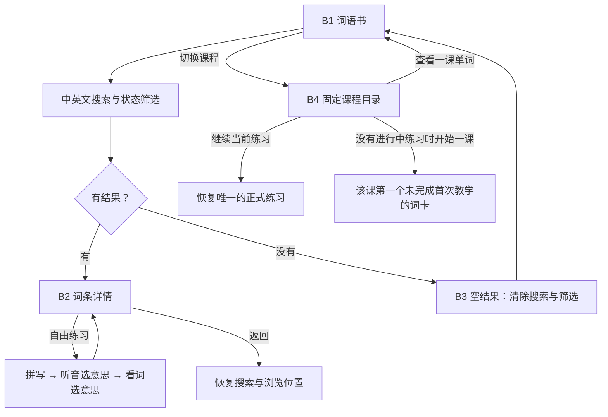

- 「查单词 / 课程」切换放在顶部。
- 列表行显示英文、中文与「未开始 / 正在学 / 学过 / 记牢了」状态；状态筛选可展开，保持页面整洁。
- 课程按固定课次排列，显示「未开始 / 未学完 / 已学过」。这些标签由课内 5 个词的状态计算；复习出错不取消一课已完成首次教学的状态。
- 有正式练习进行中时，目录上方只显示一个「继续当前练习」入口，标明新课或复习及当前题目。课程行可「查看」该课单词；完成当前练习后，未学完课程提供「开始」操作。
- 点击词条打开完整词卡，下方进入自由练习；返回保留搜索条件和滚动位置。
- 新课与到期复习共用一份续学位置；完成后展示结果，离开结果页时释放。自由练习使用当前页面的临时状态，返回或刷新后可重新练习，保留正式练习的续学位置。
- 查看当前尚未结算的复习词详情或做该词自由练习，记为本轮查看提示；原题返回时保留此标记。

课程目录读取固定内容与每词当前进度；本轮结果用于即时反馈，离开后释放。课程状态和进度统计的保存范围见[项目数据范围](../../PROJECT.md#6-保存与导出)。

## 6. 家长设置：详细进度与一键导出

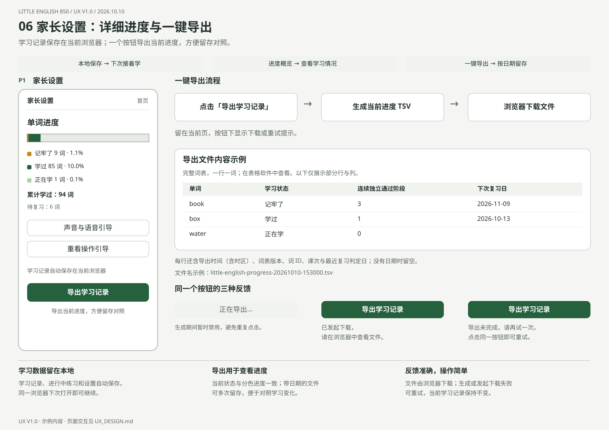

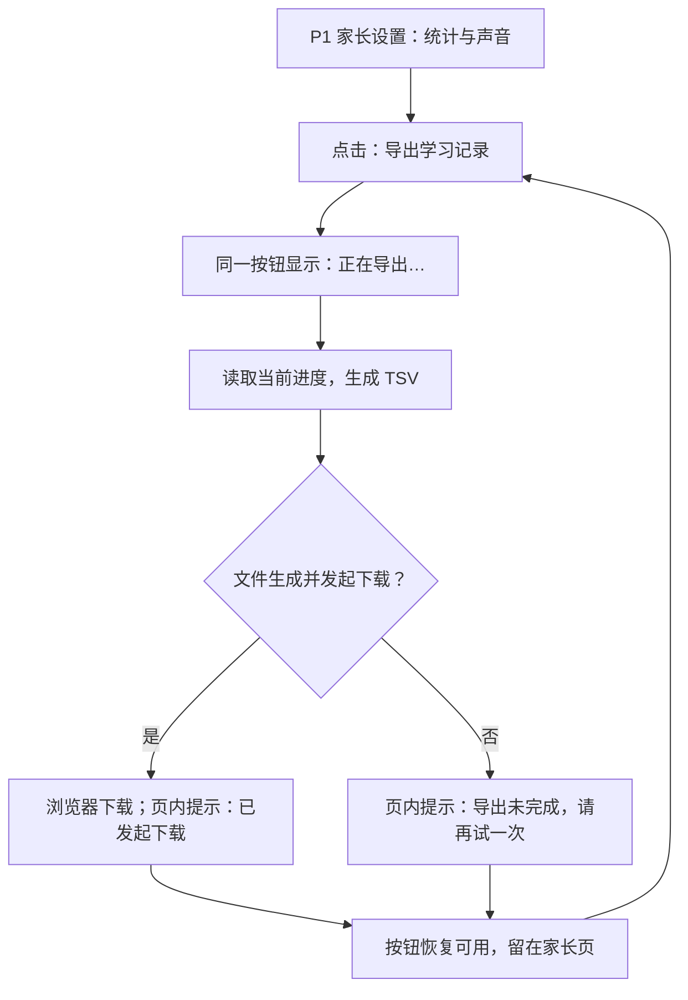

概览显示正在学、学过、记牢了各自的词数与百分比，并单列「累计学过＝深绿＋金色」和「待复习」词数。待复习按已完成首次教学、下次复习日为今天或更早、且今天尚未判定的单词计算；全部统计直接读取当前单词记录。声音设置包括语音引导、音量和试听，并保留重看操作引导。

学习记录、进行中练习和设置均自动保存在本地浏览器。页面显示「学习记录自动保存在当前浏览器」，下方只有一个数据操作按钮「导出学习记录」，点击后直接下载文件。

### 导出文件与反馈

采用 **UTF-8 TSV**，可用表格软件或文本编辑器查看。文件名为 `little-english-progress-YYYYMMDD-HHmmss.tsv`。每次导出记录当时的学习进度，便于按日期留存对照；列顺序见[保存与导出](../../PROJECT.md#6-保存与导出)。

| 文件内容 | 约定 |
| --- | --- |
| 范围 | 完整 850 词，一行一词，含中文表头 |
| 标识 | 每行带相同的导出时间（含时区）与词表版本，以及该词的稳定 ID、英文和固定课次；课次来自词库编排 |
| 学习状态 | 未开始 / 正在学 / 学过 / 记牢了，与分色进度一致；「未开始」表示尚未进入新课词卡 |
| 复习记录 | 连续独立通过阶段（0–3）、最近复习判定日、下次复习日；没有日期时留空 |
| 首次使用 | 所有词为未开始，通过阶段为 0，复习日期为空，仍可正常导出 |

| 按钮状态 | 页内反馈 |
| --- | --- |
| 可用 | 「导出学习记录」；下方「导出当前进度，方便留存对照」 |
| 处理中 | 同一按钮显示「正在导出…」，暂时禁用以免重复点击 |
| 已发起下载 | 按钮恢复；提示「已发起下载，请在浏览器中查看文件」 |
| 生成或发起下载失败 | 按钮恢复；提示「导出未完成，请再试一次」，可点击同一按钮重试 |

导出期间保持当前学习记录和练习状态。页面仅在发起下载后显示相应提示，最终文件保存由浏览器处理。

## 7. 共用状态与设备布局

| 状态 | 显示与下一步 |
| --- | --- |
| 暂停成功 | 「进度已保存，下次可以接着学」；继续练习或返回首页 |
| 保存失败 | 「这次进度还没保存，先别关闭页面」；重试保存，成功后清除提示 |
| 已存数据无法读取 | 「学习记录暂时无法读取」；保留原数据并显示重试入口，读取成功后恢复页面 |
| 音频加载 / 失败 | 正在准备声音；失败可重放或暂停，听音题保持未完成 |
| 图片失败 | 显示替代说明；题意不足时提供重新加载 |
| 刷新续学 | 恢复唯一的当前正式练习及其原题、输入、错误与提示记录；自由练习可重新开始 |

| 元素 | 手机 | 平板与电脑 |
| --- | --- | --- |
| 首页 | 单列、一个主按钮；整条进度可见 | 保持简洁居中，不因屏幕大而增加统计卡片 |
| 进度条 | 高约 24 px；外框清楚，三种文字图例在下方 | 同样的分段比例与图例 |
| 学习页 | 顶部短进度；题目、反馈和输入在键盘出现时仍可见 | 内容居中，宽约 560–720 px；使用实体键盘 |
| 词语书 | 搜索与查词 / 课程切换，单列列表 | 可将筛选与列表分栏 |
| 家长设置 | 单列概览和设置，一个导出按钮；反馈在按钮附近 | 居中面板 |

中文正文建议 18–20 px、单词 32–40 px、主按钮高 52 px；所有可点目标至少 44×44 CSS px。文字对比度至少 4.5:1，焦点可见；反馈同时用文字表达，答对后由孩子点击继续。

## 8. UX 走查任务

| 任务 | 经过的视图 | 检查重点 |
| --- | --- | --- |
| 首次学一个单词 | H1 → W1 → W2 → W3 → W4 → R2 | 从单词直接开始；听、选、拼、跟读入口清楚 |
| 看首页进度 | H1 / H2 / H3 / H4 → 进度图例 | 理解三种颜色；首页用短标签，详细统计在家长设置 |
| 拼写出错 | W4 → R1 → W4 | 留在当前词，清空后可重新输入 |
| 暂停续学 | 学习页 → 首页 H2 → 原题 | 输入与本轮错误记录保留 |
| 到期复习 | H3 → R3 → 结果 | 回忆在先，完成后更新分段颜色 |
| 查词或选课 | B1 → B2 / B4 | 课程状态由单词计算；有练习时只提供一个继续入口，无练习时可开始指定课程 |
| 正式练习中查词 | 练习 → B1 / B4 → 原练习 | 原题目、输入和错误标记保留；复习途中查当前词答案计提示；完成后才开始另一轮 |
| 导出学习记录 | P1 → 导出按钮 → 浏览器下载 | 一个按钮完成；文件包含当前词条状态，中文、日期和数量正确 |
| 导出反馈 | P1 → 正在导出 → 下载提示 / 重试 | 防止重复点击；失败可再次导出，学习记录保留 |
| 空搜索 | B3 → 清除搜索与筛选 → B1 | 返回词条列表，保留清楚的下一步 |

依据：[产品说明](../../PROJECT.md)、[开发说明](../DEVELOPMENT.md)、[内容与素材规范](../CONTENT.md)。
